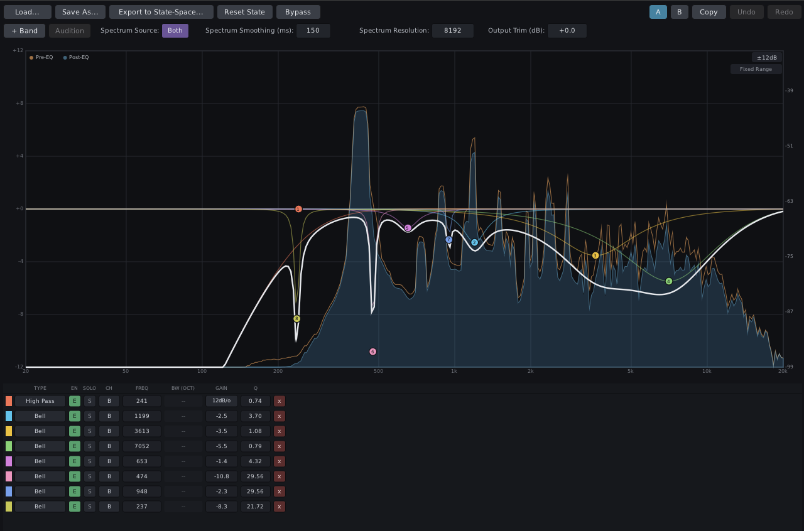
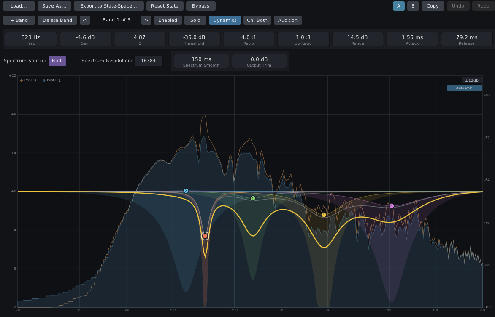
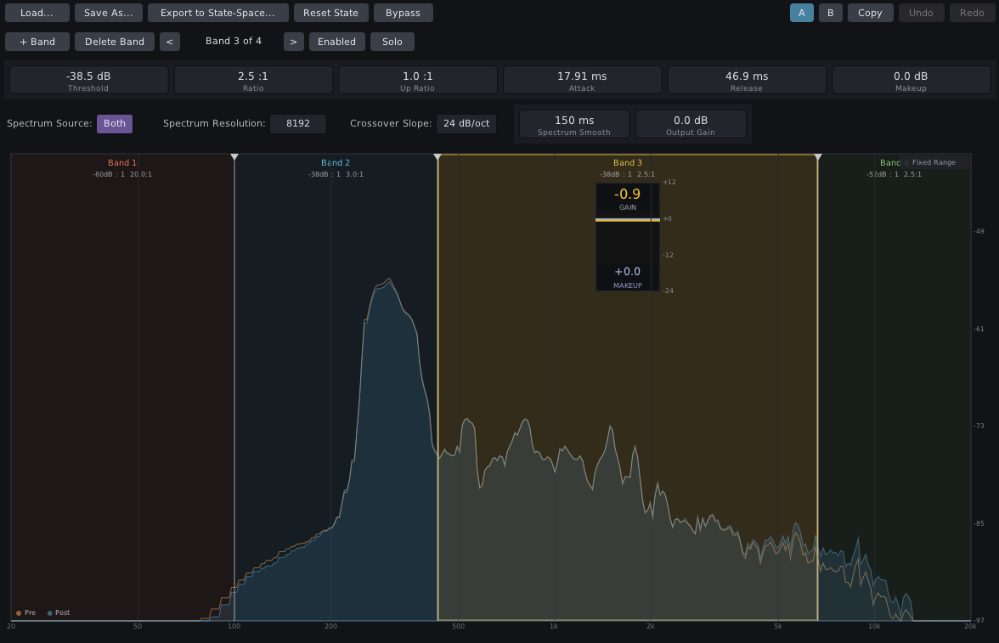
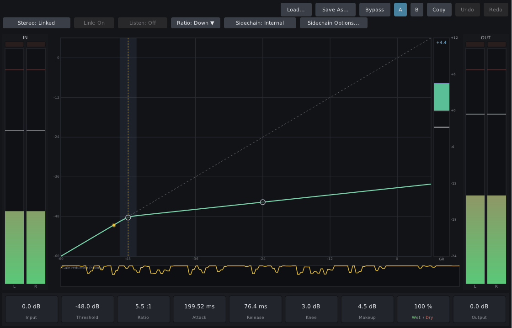

# MimoMusic plugins

Open-source audio plugins (LV2, VST3 and standalone JACK) built with
[DPF](https://github.com/DISTRHO/DPF), developed and tested in Ardour.
All projects share the same GUI toolkit, controls and build tooling.



| Folder | Plugins |
|---|---|
| [`amplifier/`](amplifier) | Amplifier Mono, Amplifier Stereo |
| [`statespace/`](statespace) | Matrix Filter, Parametric EQ, Parametric EQ Mono, Multiband Compressor, Dynamic EQ, Dynamic EQ 2 |
| [`compressor/`](compressor) | Compressor Mono, Compressor Stereo, Contour, Contour Mono, Limiter |
| [`meters/`](meters) | Phase Scope, Loudness Meter |
| [`reverb/`](reverb) | Reverb Dense, Reverb Plate |

Each folder has its own README with the details of its plugins.

| Dynamic EQ | Multiband Compressor | Compressor |
|---|---|---|
|  |  |  |

## Getting the source

The build needs DPF, which is included as a git submodule. Clone with:

```sh
git clone --recursive https://github.com/mimo-music/mimomusic-plugins.git
```

If you already cloned without `--recursive`, run
`git submodule update --init --recursive` in the checkout. The ZIP
download from GitHub does not contain the submodules, so use git.

## Building on Linux

Install the build dependencies. On Debian or Ubuntu:

```sh
sudo apt-get install build-essential cmake pkg-config git \
    libx11-dev libxext-dev libxcursor-dev libxrandr-dev \
    libgl1-mesa-dev libglu1-mesa-dev \
    libjack-jackd2-dev libasound2-dev
```

Then build everything:

```sh
./build_and_install.sh              # build all projects and install the LV2 bundles into ~/.lv2/
./build_and_install.sh --no-install # build only
./build_and_install.sh --test       # also run each project's regression tests
./build_and_install.sh --clean      # start from an empty build directory
```

The script runs each project's own `build_and_install.sh` in turn and
prints a summary at the end. To build a single project, run its script
directly, for example `./compressor/build_and_install.sh --test`.

Build output goes to `builds/<project>/`. Set `MIMOMUSIC_BUILDS_ROOT` to
put it somewhere else. Besides the LV2 bundles, every build also produces
VST3 bundles and standalone JACK programs in `builds/<project>/build/bin/`;
copy the `.vst3` folders into `~/.vst3/` to use them.

## Uninstalling

```sh
./uninstall.sh --dry-run   # list the installed MimoMusic plugins, remove nothing
./uninstall.sh             # list them, ask, then remove
./uninstall.sh reverb      # only one project's plugins
```

It removes only this repository's plugins (LV2 and VST3, and on macOS
also AU), and only bundles that really are MimoMusic plugins; other
plugins in the same folders are never touched. Restart Ardour or rescan
plugins afterwards.

## Building on macOS

`./build_and_install_macos.sh` is the macOS counterpart, run on a Mac.
It needs the Xcode Command Line Tools (`xcode-select --install`) and
cmake (installed via Homebrew if missing), builds every plugin as a
universal binary (Apple Silicon + Intel) in LV2, VST3 and AU format, and
installs them into `~/Library/Audio/Plug-Ins/`. It accepts the same
flags as the Linux script, plus `--arch` and `--min-macos`.
`./uninstall.sh` works on macOS too.

The macOS scripts have not yet been tested on a real Mac. Reports and
fixes are welcome.

## License

GNU General Public License, version 3 or later (GPL-3.0-or-later), see
[LICENSE](LICENSE). Copyright (C) 2026 Mettronic GmbH. MimoMusic is a
brand of Mettronic GmbH. Other licensing terms (for example for
commercial or embedded use) are available from Mettronic GmbH.

DPF and the libraries it bundles keep their own licenses.

## Contributing

Contributions are welcome. Please read [CONTRIBUTING.md](CONTRIBUTING.md)
and the [Contributor License Agreement](CLA.md) before opening a pull
request.
